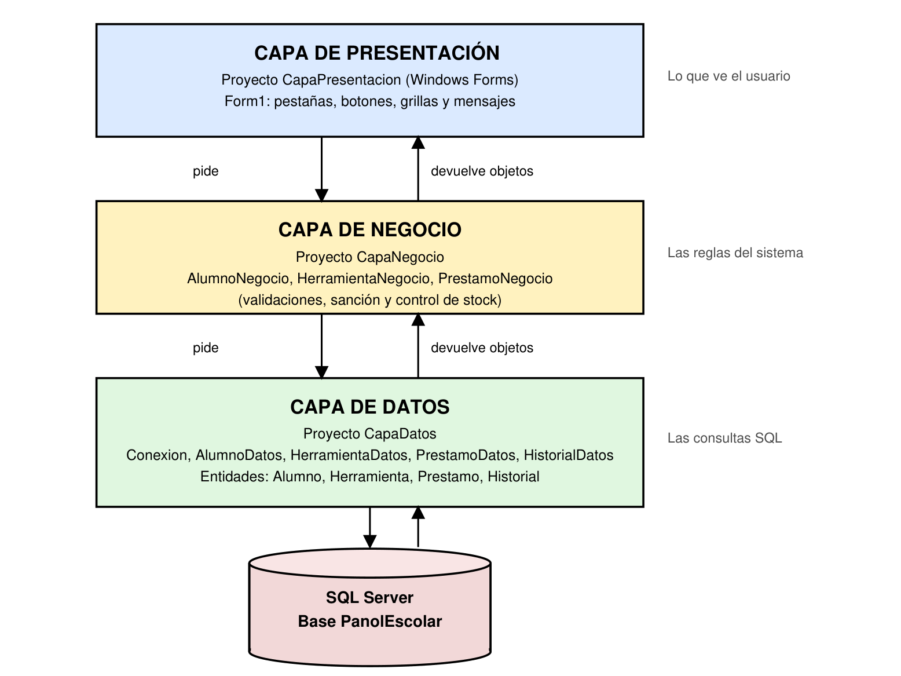
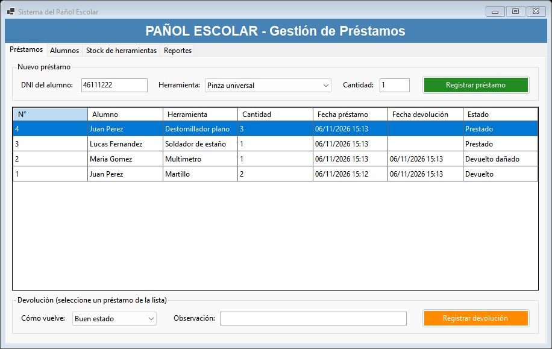

# Sistema de Gestión de Préstamos del Pañol Escolar

Trabajo Integrador Individual — **Modelos y Sistemas — 7mo Año** (Escuela Técnica)
Opción A: Sistema de Gestión de Préstamos de Pañol Escolar.

Sistema hecho en **C# (Windows Forms)** con base de datos **SQL Server**, usando **programación orientada a objetos** y separado en **3 capas**.

## ¿Qué hace?

- **Préstamos:** registra la entrega de herramientas a un alumno y su devolución (en buen estado o dañada).
- **Alumnos:** alta de alumnos y manejo de sanciones.
- **Stock de herramientas:** cuántas hay en total, disponibles, prestadas y dañadas.
- **Reportes:** reporte de insumos dañados e historial de estado de cada herramienta.

Reglas del sistema:
- Un alumno con sanción activa no puede pedir herramientas.
- No se puede prestar más de lo que hay disponible.
- Si una herramienta vuelve dañada, no vuelve al stock y el alumno queda sancionado.

## Estructura del repositorio

```
TP_Panol_Escolar/
├── PanolEscolar.sln            Solución de Visual Studio
├── CapaPresentacion/           Formulario (Windows Forms)
├── CapaNegocio/                Reglas del sistema
├── CapaDatos/                  Conexión a SQL Server, consultas y entidades
│   └── Entidades/              Alumno, Herramienta, Prestamo, Historial
├── BaseDeDatos/
│   └── PanolEscolar.sql        Script para crear la base con datos de prueba
├── Capturas/                   Capturas de pantalla y diagramas
├── Documentacion_TP_Panol_Escolar.pdf   Documentación completa del TP
└── Presentacion_TP_Panol_Escolar.pptx   Presentación para exponer
```

## Arquitectura en 3 capas

| Capa | Proyecto | Qué hace |
|---|---|---|
| Presentación | `CapaPresentacion` | La ventana: toma los datos y muestra resultados. No tiene SQL. |
| Negocio | `CapaNegocio` | Validaciones, sanciones y control de stock. |
| Datos | `CapaDatos` | Se conecta a SQL Server y convierte las filas en objetos. |



## Cómo ejecutarlo

1. Abrir **SQL Server Management Studio**, conectarse a `.\SQLEXPRESS` y ejecutar `BaseDeDatos/PanolEscolar.sql` (F5).
2. Abrir `PanolEscolar.sln` con **Visual Studio 2026** (o 2022 con .NET 10).
3. Si el servidor SQL tiene otro nombre, cambiar la cadena de conexión en `CapaDatos/Conexion.cs`.
4. Verificar que **CapaPresentacion** sea el proyecto de inicio y presionar **F5**.

## Documentación

En [Documentacion_TP_Panol_Escolar.pdf](Documentacion_TP_Panol_Escolar.pdf) están todos los apartados de la consigna:

1. Marco conceptual y clasificación
2. Documentación paso a paso (registrar un préstamo)
3. Diagrama de flujo del proceso
4. Caso de uso formal
5. Captura anotada de la interfaz


